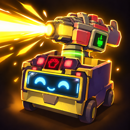

<p align="center">
  
</p>

# HELL PARTY · 헬파티

**호스트 한 명만 설치하세요. 모드 없는 친구들과 순정 그대로 함께 즐길 수 있습니다.**

> 참가자는 추가 모드나 BepInEx를 설치할 필요가 없습니다. 호스트가 헬파티를 설치하면 함께 들어온 순정 플레이어도 새로운 몬스터 능력과 웨이브를 경험합니다.

**왕관 쓴 오리가 친구를 데려왔고, 풍선에서는 노움이 튀어나옵니다.**

익숙한 R.E.P.O.의 수집 임무가 몬스터들의 지옥 파티로 바뀝니다. 전리품을 집기 전에도, 도망치기 전에도, 마지막 한 발을 쏘기 전에도 주변을 한 번 더 살펴보세요. 헬파티는 몬스터마다 새로운 속임수와 협공을 더해, 친구들과 함께 비명을 지르고 웃을 순간을 만듭니다.

[달라진 몬스터들](#달라진-몬스터들) · [몬스터 웨이브](#물건-하나-깨졌을-뿐인데-몬스터-웨이브) · [설치](#설치) · [개발 문서](#개발과-기여)

## 이번 수집은 조금 다릅니다

- **눈을 떼면 따라오는 인형.** 평범한 물건처럼 멈춰 있다가 등을 돌린 틈을 노립니다. 잡으려다 화까지 돋우면, 이제 쳐다보는 것만으로는 막을 수 없습니다.
- **싸움이 싸움을 부릅니다.** 몬스터를 때렸더니 지원군이 튀어나오고, 쓰러뜨렸더니 더 위험한 뒷정리가 기다립니다.
- **위험한 만큼 탐나는 보상.** 진짜 오리의 왕관, 벨라가 남긴 물건, 광대의 마법 지팡이까지. 살아서 챙겨 나올 수 있을까요?

## 달라진 몬스터들

아래는 각 몬스터의 **최종 강화 형태**를 플레이어 관점에서 소개한 내용입니다. 정확한 수치와 해금 조건은 밸런스 조정에 따라 바뀔 수 있습니다.

| 몬스터 | 이제 마주치면 벌어지는 일 |
| --- | --- |
| **Apex Predator · 오리** | 최대 세 마리의 분신과 함께 몰려옵니다. 가짜를 잡으면 방사능 가스가 남습니다. 왕관 쓴 본체를 찾아 처치하면 분신도 정리되고 왕관은 전리품이 됩니다. |
| **Animal · 애니멀** | 가까이 다가오면 쫓는 플레이어의 발밑에 독가스를 깝니다. 처치하면 체력이 낮은 두 마리로 갈라집니다. 사라지기 전에 사냥한 만큼 코어를 챙기세요. |
| **Bella · 벨라** | 자전거에 폭탄 인형을 태우고 벨에 맞춰 자폭 예고를 합니다. 주변에 떨어뜨린 작은 보물을 잡으면 곧바로 달려듭니다. 처치 후 남은 물건은 챙길 수 있습니다. |
| **Birthday Boy · 생일보이** | 풍선 옆에 오래 머물거나 풍선을 터뜨리면 노움이 튀어나옵니다. 본체를 때리면 근처 풍선들이 한꺼번에 터지며 지원군이 같은 목표를 노립니다. |
| **Bowtie · 보우타이** | 바람 공격과 함께 목표 곁에 엘사를 불러 근육질로 변신시킵니다. 보우타이를 처치한 자리에서도 복수의 엘사가 나타납니다. |
| **Chef · 셰프** | 개구리 장식품으로 변장합니다. 집는 순간 잡기를 풀고 본모습으로 덤벼듭니다. 정체를 알아봤다면 변장 물건을 부숴 처치 보상을 받을 수도 있습니다. |
| **Upscream · 업스크림** | 커다란 전리품으로 숨어 있습니다. 집었다가 본모습으로 돌아온 업스크림에게 던져질 수 있으니, 큰 물건을 발견했다고 바로 기뻐하진 마세요. |
| **Cleanup Crew · 청소부** | 폭발헤드가 끝이 아닙니다. 헤드가 터진 자리에서 잠시 뒤 업스크림이 태어나 원래 목표를 쫓고, 던지기를 성공시키면 사라집니다. |
| **Clown · 광대** | 공격에 레이저 지팡이를 더합니다. 아직 목표를 잡지 않은 광대에게 총을 쏘면 피해를 막고 지팡이로 반격합니다. 발사 전 옆으로 피하고, 본체 처치 후 남은 지팡이는 챙기세요. |
| **Mentalist · 멘탈리스트** | 아직 누구도 쫓지 않을 때 총으로 기습하면 공격을 막고 레이저총으로 되갚습니다. 조준은 처음 위치에 고정되니, 레이저가 나오기 전에 움직이세요. |
| **Huntsman · 헌트맨** | 가까운 플레이어를 등에 업고 납치합니다. 동료가 헌트맨을 때리거나 넘어뜨리면 구출할 수 있습니다. 처치한 뒤에도 핀이 뽑힌 수류탄을 조심하세요. |
| **Loom · 룸** | 스토커를 데리고 등장하며 가까운 플레이어를 납치합니다. 동료가 이미 납치됐다면 다른 납치는 이어지지 않으니, 먼저 구출할 기회를 노리세요. |
| **Robe · 로브** | 혼자 오지 않습니다. 로브와 함께 나타난 스토커는 독립적으로 움직이며 가장 가까운 플레이어의 뒤를 밟습니다. |
| **Stalking Doll · 스토커** | 아무도 보지 않을 때 조용히 따라옵니다. 잡기를 반복하거나 공격을 한 번 허용하면 분노해, 보고 있어도 빠르게 달려듭니다. 누군가 죽거나 한동안 유효타를 못 내면 진정합니다. |
| **Peeper · 피퍼** | 피해를 줄 때마다 노움을 부르고 때때로 뱅거도 더합니다. 붙들린 사이 적이 늘어나니 동료의 빠른 도움이 중요합니다. |
| **Elsa · 엘사** | 혼자 떨어진 사람을 따라오다가 가까워지면 공격형으로 변신합니다. 동료가 가까이 합류하면 즉시 순한 모습으로 돌아오니, 일행과 거리를 유지하세요. 보우타이의 소환 엘사는 이 규칙과 별개입니다. |
| **Headman · 헤드맨** | 근처 동료가 쫓는 사람을 함께 노리고, 동료를 공격한 플레이어도 추적합니다. 한 마리만 상대한다고 생각했다가 협공을 당할 수 있습니다. |
| **Trudge · 트러지** | 철퇴를 내려찍은 자리에 잠시 뒤 Tick·Gnome·Banger 중 두 마리가 합류합니다. 내려찍기를 피한 뒤에도 지원군이 나올 공간을 살피세요. |
| **Reaper · 리퍼** | 거리를 벌리면 헤드맨으로 바뀌어 빠르게 추격하고, 가까워지면 다시 리퍼로 돌아와 공격을 잇습니다. 달아나는 동안에도 뒤를 확인하세요. |
| **Shadow Child · 차일드** | 같은 사람을 계속 노리면 그 사람의 시야 높이에 독가스를 반복해서 만듭니다. 화면이 가려지기 시작했다면 그 자리에서 벗어나세요. |

### 지원군도 만나게 됩니다

**소환 Elsa**는 보우타이의 근육질 지원군으로, **Gnome·Banger·Tick**은 여러 협공의 일원으로 등장합니다. **Spewer**는 청소부의 부화 지원군으로, **Rugrat·Headgrab**은 웨이브의 사각지대 습격에 합류합니다. 누구에게 소환됐는지에 따라 수명과 코어 보상이 다르니 모든 지원군을 같은 사냥감으로 보진 마세요.

**Gambit·Heart Hugger·Hidden·Oogly**에는 별도 추가 능력을 부여하지 않습니다. 이들을 포함한 순정 몬스터들도 계속 등장하므로, 익숙한 대응법과 새로운 위협을 함께 기억해야 합니다.

## 물건 하나 깨졌을 뿐인데: 몬스터 웨이브

가치품이 깨진 자리에서 축음기가 나타나고 음악이 흐릅니다. **3초 안에 주변의 모두가 웅크리거나 기어서 숨으면 습격을 피할 수 있습니다.** 누군가 서 있다면, 보이지 않는 곳에서 몬스터들이 몰려오기 시작합니다.

Rugrat·Upscream·Headgrab이 합류하고 노움들이 뒤를 잇습니다. 음악이 시작된 순간부터 20초를 버텨야 합니다. 축음기를 잡으려 하면 피해를 받으니, 동료에게 숨으라고 알리거나 함께 싸울 자리를 잡으세요.

## 설치

1. **호스트**의 BepInEx 프로필에 HellParty를 설치합니다. 모드 매니저에서는 필요한 BepInExPack을 함께 설치합니다.
2. 참가자는 순정 게임으로 접속합니다. 별도의 필수 설정 없이 실제 진행도에 맞춰 능력이 적용됩니다.
3. 로컬 배포 후보를 사용한다면 ZIP을 매니저의 로컬 모드로 가져오세요. 수동 설치는 BepInEx가 설치된 게임의 `BepInEx/plugins/HellParty/`에 `HellParty.dll` 하나를 둡니다.

설치·업데이트·제거는 게임을 종료한 뒤 진행하세요. 수동 설치한 이전 DLL이 다른 플러그인 폴더에 중복으로 남아 있지 않은지 확인하면 됩니다.

## 문제를 발견했다면

게임·HellParty 버전, 호스트/참가자 구분, 함께 사용한 모드, 어떤 상황에서 재현되는지와 관련 `BepInEx/LogOutput.log` 줄을 저장소 Issues에 남겨주세요. 바닐라 참가자에게만 보이는 문제라면 그 상황도 함께 알려주세요.

## 개발과 기여

헬파티는 호스트가 추가 행동을 제어하고 순정 프리팹·애니메이션·동기화 경로로 참가자에게 전달합니다. 현재 빌드는 R.E.P.O. 0.4.4 참조를 사용하며, 실제 게임 호환 범위는 설치된 게임 계약 검사와 플레이테스트로 확인합니다.

- [개발 환경과 빌드](docs/development.md)
- [플레이테스트 모음](docs/playtests/README.md)
- [몬스터 상세 기획](docs/monsters/README.md) · [능력 기획표](docs/monster-abilities.md)
- [몬스터 웨이브 상세](docs/events/monster-wave.md)
- [배포 준비와 검증](docs/release-readiness.md) · [아이콘 제작 자료](assets/branding/README.md)

```powershell
powershell.exe -NoProfile -ExecutionPolicy Bypass -File .\scripts\Test-Dev.ps1 -Offline
powershell.exe -NoProfile -ExecutionPolicy Bypass -File .\scripts\Verify-Release.ps1 -Offline
```

자동 검사는 게임 안의 실제 연출·원격 피해 확인을 대신하지 않습니다. 새 프로필과 바닐라 참가자를 사용한 최종 확인은 플레이테스트 문서를 따릅니다.

R.E.P.O.와 원래 몬스터 디자인은 semiwork의 작품입니다. HellParty는 비공식 팬 모드입니다.
